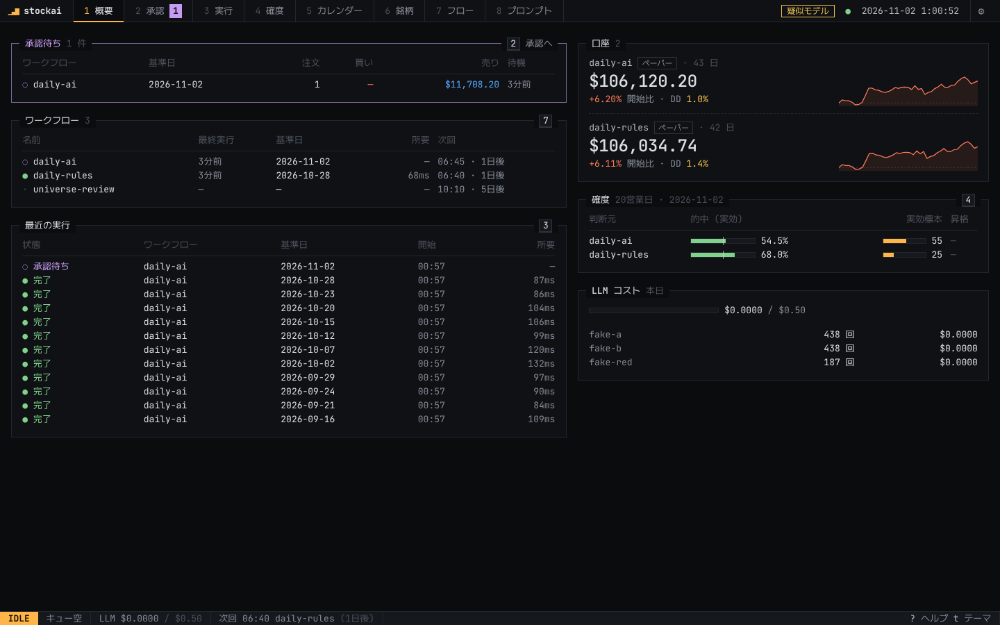
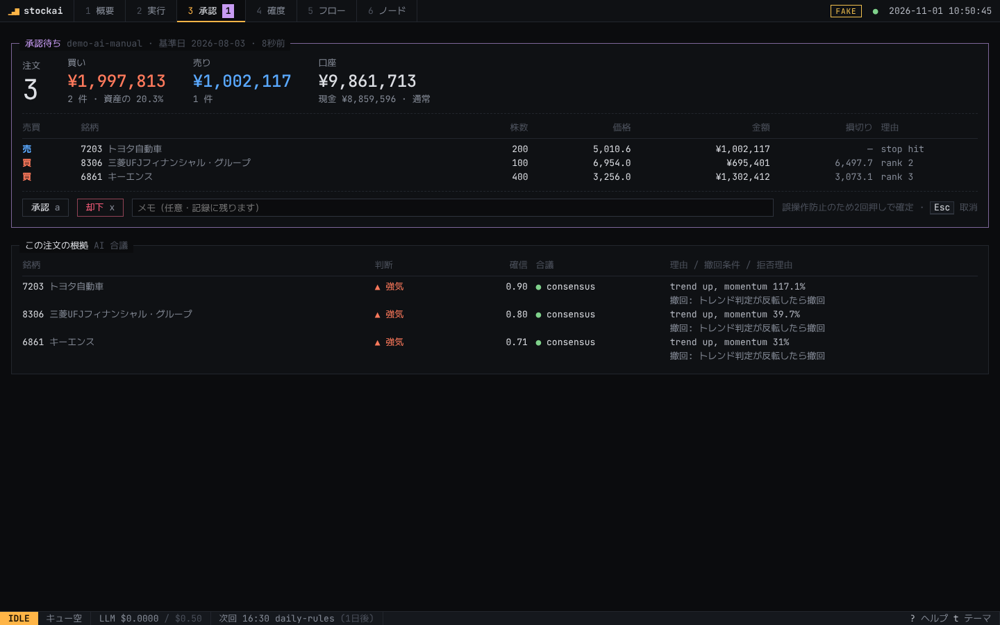
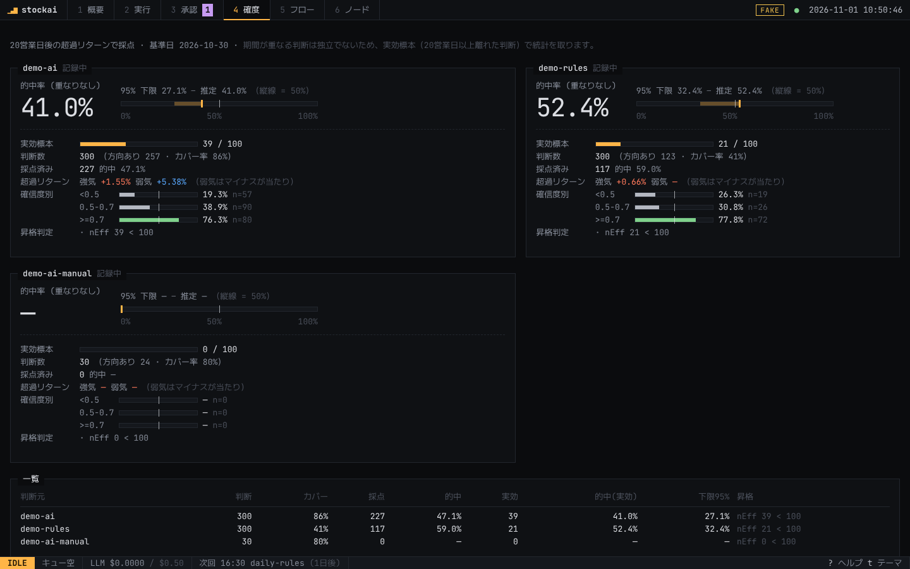
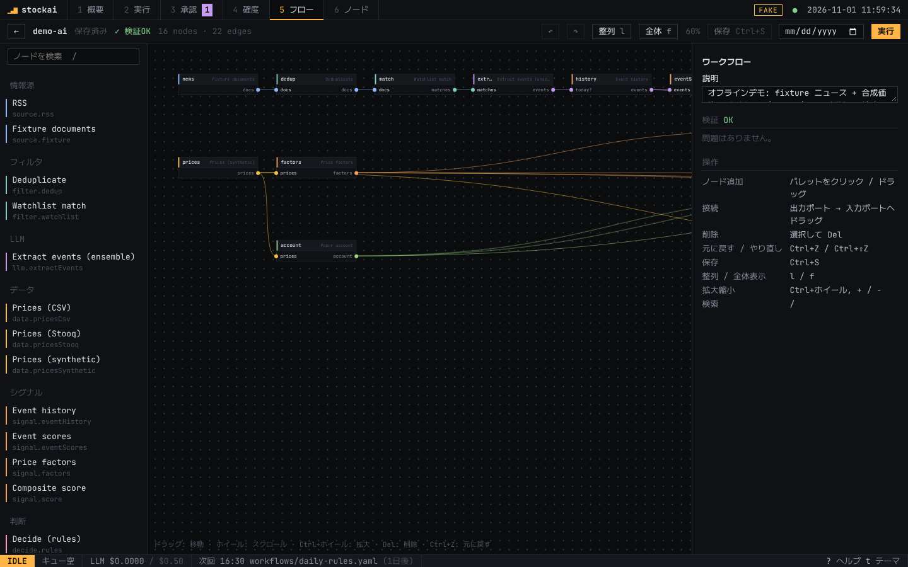
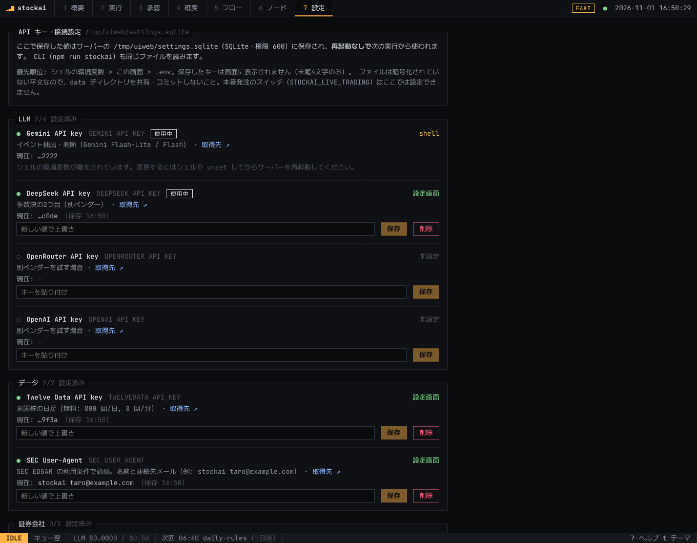

# stockai — 安価な LLM で動く中期 AI 株トレーディングシステム

数週間〜数ヶ月保有の **中期売買** を、Gemini Flash-Lite 級などの **安いモデルの組み合わせ** で行うシステム。
**AI が「何を・いつ」売買するかを判断し、決定論的なルールが「いくら・どこまで損するか」を縛る。**
AI に渡す権限は、判断を全件記録して答え合わせした **実測の確度** に応じて段階的に広げる。

**既定は米国株**（価格 Twelve Data・開示 SEC EDGAR・英語ニュース）。日本株用の設定も残している。

設計: **[docs/DESIGN.md](docs/DESIGN.md)** ・ 米国株: **[docs/us.md](docs/us.md)** ・ プロンプトと評価: **[docs/prompts.md](docs/prompts.md)** ・ MCP: **[docs/mcp.md](docs/mcp.md)**



## 特徴

- **ワークフロー**: 処理は型付きノードのグラフ (`workflows/*.yaml`)。キャッシュ・失敗時の方針・承認待ち/再開・過去日付の再生・全入出力の記録
- **ハーネス**: スキーマ検証 + 再試行 / 原文照合 / 異系統モデルの多数決 / 事実の読み取りチェック / 反対役の拒否権 / キャッシュ / 日次予算
- **確度の計測**: AI とルールのベースラインを並走させ、20営業日後に採点。重なりを除いた実効標本数と Wilson 下限で昇格を判定
- **fail-safe**: 合意なし → 棄権、予算超過・反対役の失敗 → 買わない

## 構成

```
packages/core/src/
  harness/    H1–H5: structured / grounding / ensemble / cache / budget
  llm/        Gemini, OpenAI互換 (DeepSeek/OpenRouter/Groq…), Fake, オフライン用ヒューリスティック
  signals/    RSS, 重複除去, 銘柄辞書, イベント抽出, イベントスコア, テクニカル指標
  ai/         AI 売買判断 (資料作成, 読み取りチェック, 反対役)
  strategy/   ファクター, スコア合成, リスク制限, リバランス提案
  data/       Twelve Data (米国株の日足) と価格のローカル保存, SEC EDGAR
  execution/  ペーパー口座, IBKR / ウィブル証券クライアント, 発注前ガード, 注文・ポジション台帳
  eval/       判断の記録と採点 (scorecard)
  workflow/   エンジン (型付きポート, 検証, キャッシュ, 承認, 再生, イベントログ)
  nodes/      組み込みノード (stockai nodes で一覧)
  cli/        CLI
apps/web/     Web UI (React + Vite) と API サーバー (node:http, SSE, 実行キュー, スケジューラ), MCP サーバー (/mcp と stdio)
workflows/    daily-ai / daily-rules (米国株), daily-jp-ai / daily-jp-rules (日本株), webull-us / webull-jp (ウィブル証券),
              ibkr-paper (IBKR ペーパー口座), demo-ai / demo-rules (オフラインデモ)
deploy/ibkr/  IB Gateway の Docker 構成
config/       config.example.yaml (米国株), config.jp.example.yaml (日本株)
```

## Web UI

ターミナル風の Web 画面。キーボードだけで操作できる（`?` でキー一覧、`t` で ink / paper テーマ、`u` で値動きの色を日本式 ⇄ 米国式）。

| 画面 | 内容 |
|---|---|
| 1 概要 | 承認待ち・ワークフローの状態と次回実行・口座の推移・確度・LLM コスト |
| 2 実行 | 実行履歴、判断 / 注文 / 約定 / 口座 / 採点、フローのグラフ（ノードごとの状態・計測・エラー） |
| 3 承認 | 注文の一覧と根拠（AI の判断理由・撤回条件）。`a` / `x` を2回押して承認 / 却下 |
| 4 確度 | AI とルールの的中率、95% 下限、実効標本、確信度別、昇格判定 |
| 5 フロー | ワークフローのグラフ、今日 / 過去日付での実行、**ノードエディタ**（`e` 編集 / `n` 新規）、**YAML のアップロード**（`u` またはドラッグ＆ドロップ）、**無効化 / 有効化**（`d`） |
| 6 ノード | ノードの一覧（ポート型・パラメータ） |
| 7 設定 | **API キーの入力**（Gemini / DeepSeek / Twelve Data / SEC / Webull …）。保存先と、各キーがどこから来ているか（設定画面 / .env / シェル）を表示 |

| 承認 | 確度 |
|---|---|
|  |  |

### ノードエディタ



- 左のパレットからノードをクリック / ドラッグで追加。出力ポート（右）から入力ポート（左）へドラッグして接続。**型が同じポートにしかつながらない**（ドラッグ中、つなげる先だけが光る）。循環もその場で拒否
- 右のインスペクタでノード名（変更すると参照も書き換わる）、パラメータ（ノード定義の JSON Schema からフォームを自動生成）、`onError`、キャッシュ、`after` を編集
- 編集のたびにサーバーで検証し、問題のあるノードに印。問題があっても下書きとして保存できるが、直すまで実行できない
- `Ctrl/⌘+Z` 元に戻す・`Ctrl/⌘+⇧+Z` やり直し・`Ctrl/⌘+S` 保存・`Del` 削除・`l` 自動整列・`f` 全体表示・`Ctrl/⌘+ホイール` 拡大縮小
- 保存先は `workflows/<name>.yaml`（1ノード1行の YAML）。上書き時は直前の版を `.bak` に残す。YAML のコメントは保存時に消える
- 「保存して実行」で実行し、各ノードの状態がキャンバス上でリアルタイムに変わる

### ワークフローのアップロードと無効化

- **アップロード**: 「5 フロー」の `↑ YAML`（`u`）でファイルを選ぶか、一覧に `.yaml` をドラッグ＆ドロップ。ファイルの `name:` がワークフロー名になり、`workflows/<name>.yaml` に**コメントもそのまま**保存される。同じ名前があるときは上書きの確認が出る（直前の版は `.bak`）。ノードの種類や接続に問題があっても下書きとして保存し、直すまで実行できない
- **無効化**: `⏸ 無効にする`（`d`）でスケジュール・画面・CLI のどこからも実行されなくなる（YAML は書き換えない。状態は `data/` の DB に保存）。承認待ちの実行は無効化後も承認・却下できる。その日の自動実行の時刻を無効中に過ぎた場合、有効に戻してもその日は自動では動かない
- CLI: `npm run stockai -- disable daily-ai [--note 理由]` / `npm run stockai -- enable daily-ai`

```bash
npm run web                     # UI をビルドしてサーバー起動 → http://127.0.0.1:4317
npm run web -- --fake           # API キーなし (疑似モデル)
npm run web:server & npm run web:ui   # 開発: Vite (http://127.0.0.1:5173) + API サーバー
```

- 既定で `127.0.0.1` のみで待ち受ける。他の端末から使う場合は `STOCKAI_WEB_TOKEN` を設定して `--host 0.0.0.0`（トークンなしでは起動を拒否）。初回は `http://host:4317/?token=...` で開く
- 実行はキューで1つずつ処理。進行状況はサーバーからリアルタイムに反映される

## 通知・バックアップ・ウォッチリスト

すべて「7 設定」画面から。

- **Discord 通知**: Discord のチャンネル設定 → 連携サービス → ウェブフック で URL を作り、`DISCORD_WEBHOOK_URL` に貼って「テスト送信」。
  既定では **承認待ち**（注文の一覧と承認画面へのリンク）・**失敗 / 一部失敗**（どのノードがなぜ）・**ブローカーへの注文**・**バックアップ失敗** を送る。
  同じ実行について同じ通知は1回だけ。メンションは常に無効（記事の文章で @everyone が飛ばない）。種類は `config.yaml` の `notify.events` で変えられる
- **バックアップ**: サーバーの起動中、毎日 12:30 以降に1回 `data/backups/` にデータベースを丸ごとコピー（直近 14 日分 + 月ごとに 12 か月分を保持）。
  「今すぐバックアップ」または `npm run stockai -- backup`。別のディスクや同期フォルダに置くなら `backup.dir`。API キー（settings.sqlite）は既定では含めない
- **ウォッチリスト**: 銘柄・名前・別名・セクター・ベンチマークを画面で編集。`config/config.yaml` に書き戻す（コメントや他の設定は残り、直前の版は `.bak`）。
  `config.example.yaml` で起動している場合は初回の保存で `config/config.yaml` を作る。保存した時点から次の実行に反映され、再起動は不要
- **Claude と会話して銘柄を選ぶ**（MCP の「銘柄を探す」）と、**月1回の見直しワークフロー**（`universe-review`: 追加・削除の候補を出して承認待ち → 承認で反映）もある（[docs/us.md](docs/us.md)）
- **AI に銘柄を探してもらう**（米国株）: テーマを選ぶと AI が候補と理由を出し、SEC の上場企業リストで実在・取引所・社名を確認。選んだものだけ一覧に加わる（[docs/us.md](docs/us.md)）

## MCP（Claude から操作する）

Claude Desktop / Claude Code から stockai を操作できる（[docs/mcp.md](docs/mcp.md)）。
「今日の判断をまとめて」「先月分を再生してルールと比べて」「決算イベントだけ見るワークフローを作って」など。

- Web サーバーを動かしていれば `http://127.0.0.1:4317/mcp`（Claude Code: `claude mcp add --transport http stockai http://127.0.0.1:4317/mcp`）
- Claude Desktop は stdio（`apps/web/server/mcp-stdio.ts` を設定ファイルに書く）
- ツール: 状況・実行・判断・確度の読み取り、ワークフローの検証・保存・実行・無効化。**注文の承認ツールと API キーへのアクセスは無い**（承認は Web 画面で人が行う）。`--read-only` で読み取りだけにできる

## 日次運用（確度の記録）

`config/config.yaml` の `schedule` に書いたワークフローが、Web サーバーの起動中に毎日自動で実行される。

```yaml
schedule:   # 米国株: 取引終了後の日本時間の朝（火〜土）
  - { workflow: workflows/daily-rules.yaml, at: "06:40", days: [2, 3, 4, 5, 6] }   # 比較用ベースライン（先に実行し、共通ノードをキャッシュ）
  - { workflow: workflows/daily-ai.yaml, at: "06:45", days: [2, 3, 4, 5, 6] }      # AI 判断（承認ゲートで停止）
```

1. 常時起動のマシンで `npm run web` を動かしておく（API キーは「7 設定」で入れる）
2. 毎日の判断は承認しなくても記録・採点される（`record` / `grade` は承認ゲートの手前で動く）
3. 注文を承認するとペーパー口座で約定する。承認しなければ一定時間で自動的に却下扱い
4. 「4 確度」で AI とルールの差を見る。実効標本が 100 を超え、下限が 50% を上回り、ルールに勝ったら次の段階を検討する

## セットアップ

Node.js（npm 同梱）は [aqua](https://aquaproj.github.io/) でバージョンを固定して入れる（`aqua.yaml`: Node.js v22.23.4、チェックサム検証あり）。

```bash
# 1) aqua をインストール（初回のみ）
#    macOS:  brew install aquaproj/aqua/aqua
#    Linux:  インストーラのチェックサムを確かめてから実行
curl -sSfL -O https://raw.githubusercontent.com/aquaproj/aqua-installer/v4.1.1/aqua-installer
echo "c0acde4802a1edd8b8201fd4cc1f0e52700cd4feb875f9c9793381b5b0ca2065  aqua-installer" | sha256sum -c -
chmod +x aqua-installer && ./aqua-installer && rm aqua-installer

#    PATH に aqua のディレクトリを追加（~/.bashrc や ~/.zshrc に）
export PATH="${AQUA_ROOT_DIR:-${XDG_DATA_HOME:-$HOME/.local/share}/aquaproj-aqua}/bin:$PATH"

# 2) リポジトリで Node.js / npm を入れて依存を入れる
aqua i -l          # aqua.yaml のバージョンの node / npm / npx
node --version     # v22.23.4
npm ci             # .npmrc の engine-strict で、合わない Node では止まる
npm run check      # 型チェック + テスト + UI ビルド
```

- バージョンを上げるときは `aqua.yaml` を書き換えて `aqua update-checksum` を実行し、`aqua-checksums.json` も一緒にコミットする
- Alpine など musl 環境の Node はチェックサム未登録（開発環境から取得できなかったため）。必要なら musl の環境で `aqua update-checksum` を実行する

## API キーの設定

**Web UI の「7 設定」画面で入れる**のがいちばん簡単（`.env` は不要）。保存すると再起動なしで次の実行から使われる。



```bash
npm run web          # → http://127.0.0.1:4317/#/settings
# CLI でも同じ（入力は画面に表示されない）
npm run stockai -- settings                       # 一覧と、それぞれの出どころ
npm run stockai -- settings set GEMINI_API_KEY
npm run stockai -- settings clear GEMINI_API_KEY
```

| 変数 | 用途 | 取得先 |
|---|---|---|
| `GEMINI_API_KEY` | Gemini（イベント抽出・判断） | Google AI Studio |
| `DEEPSEEK_API_KEY` | DeepSeek（多数決の2つ目） | DeepSeek Platform |
| `TWELVEDATA_API_KEY` | 米国株の日足（無料: 800 回/日） | twelvedata.com |
| `SEC_USER_AGENT` | SEC EDGAR（キー不要。名前と連絡先メール、例 `stockai you@example.com`） | — |
| `JQUANTS_API_KEY` | 日本株の株価（`data.pricesJQuants`）。Free プランは直近12週間が取れないので日次運用には Light 以上 | J-Quants ダッシュボードの API Keys |
| `OPENROUTER_API_KEY` / `OPENAI_API_KEY` | 別ベンダーを試す場合 | 各社のコンソール |
| `WEBULL_APP_KEY` / `WEBULL_APP_SECRET` | ウィブル証券 | 開発者サイトで申請（[docs/webull.md](docs/webull.md)） |

- 保存先は `<dataDir>/settings.sqlite`（権限 600、git 管理外）。**暗号化はしていない平文**なので `data/` を共有・コミットしない
- 優先順位: シェルで `export` した値 > 設定画面 > `.env`（`.env` も引き続き使える: `cp .env.example .env && chmod 600 .env`）
- 画面にはキーの末尾 4 文字しか表示しない。サーバーは既定で `127.0.0.1` のみで待ち受け、別のホスト名でのアクセスは拒否する
- **本番発注のスイッチ `STOCKAI_LIVE_TRADING` は設定画面にも `.env` にも保存できない**。本番で動かすときだけ、そのシェルで明示的に設定する
- キーをチャット・Issue・コミットに貼らない。漏れたら各社のコンソールですぐ無効化して作り直す

## 使い方 (CLI)

```bash

# オフラインデモ (API キー不要・無料。疑似モデル + 合成価格なので成績に意味はない)
npm run stockai -- run workflows/demo-rules.yaml --from 2026-05-04 --to 2026-10-30 --step 5 --fake
npm run stockai -- run workflows/demo-ai.yaml    --from 2026-05-04 --to 2026-10-30 --step 5 --fake

# 本番 (米国株。要 API キー: 上の「API キーの設定」)。daily-ai は承認ゲートで止まる
cp config/config.example.yaml config/config.yaml   # 日本株なら config.jp.example.yaml
npm run stockai -- run workflows/daily-rules.yaml
npm run stockai -- run workflows/daily-ai.yaml
npm run stockai -- approve <runId> approve      # または --reject
npm run stockai -- resume <runId>

# ウィブル証券 (docs/webull.md)。既定はプレビューのみで発注しない
npm run stockai -- webull auth                   # Webull アプリでアクセスを承認 (2FA)
npm run stockai -- webull check                  # 読み取りのみ: 口座・現金・保有
npm run stockai -- run workflows/webull-us.yaml

# IBKR ペーパー口座 (IB Gateway が必要: docs/ibkr.md)
npm run stockai -- run workflows/ibkr-paper.yaml

# プロンプト・モデルの評価 (docs/prompts.md)
npm run stockai -- eval events --ensemble          # 米国株の設定では events-us.yaml × event-us-*
npm run stockai -- eval judge  --versions judge-v1,judge-v2

npm run stockai -- runs                          # 実行履歴
npm run stockai -- show <runId>                  # ノード状態・判断・注文・採点
npm run stockai -- nodes                         # ノード一覧 (--json でポート/パラメータの JSON Schema)
npm run stockai -- graph workflows/daily-ai.yaml # ノード UI 用のグラフ JSON
```

## ステータス

Phase 2 + ノードエディタ完了 (コア + ワークフロー + AI 判断 + ペーパー執行 + 採点 + IBKR 接続 + Web UI + 自動実行 + ノードエディタ)。
ブローカーは IBKR とウィブル証券の2社に対応。どちらも疑似ブローカーでテスト済みだが実際の口座では未確認 ([docs/ibkr.md](docs/ibkr.md), [docs/webull.md](docs/webull.md))。当面はシステム内のペーパー口座で確度を記録する。
米国株（Twelve Data・SEC EDGAR・英語ニュース）と設定画面を追加。データ源は公開仕様とモックで実装・テストしたもので、実際の応答は未確認（[docs/us.md](docs/us.md) のチェックリスト）。
次は実データでの日次記録。本リポジトリは投資助言ではない。
