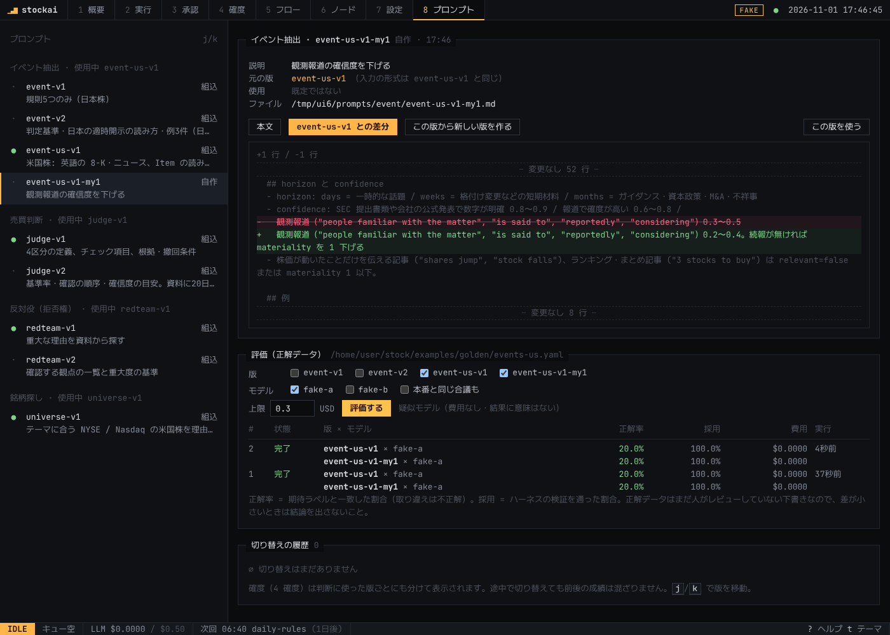

# プロンプトと評価

## 版の一覧

| 用途 | 版 | 中身 | 状態 |
|---|---|---|---|
| イベント抽出 | `event-v1` | 規則5つのみ | 既定 |
| イベント抽出 | `event-us-v1` | **米国株用**。英語の SEC 提出書類・ニュースを読む。8-K の Item の読み方（2.02 決算、4.02 決算の訂正、3.01 上場廃止通知、1.05 サイバー攻撃、5.02 役員交代、5.07 は材料なし）、コンセンサス比と前年比の区別、ガイダンスの引き上げ／据え置き、ATM 増資と既存株主の売出しの違い、例3件。evidence は英文のまま、rationale は日本語 | 米国株の既定（評価待ち） |
| イベント抽出 | `event-v2` | 判定基準（型・方向・重要度・期間・確信度の目安）、日本の適時開示の読み方（「業績予想の修正」は数字で判断、売上と利益が逆なら営業利益）、観測報道・まとめ記事・同名の別会社の扱い、例3件 | 評価待ち |
| 売買判断 | `judge-v1` | 4区分の定義、チェック項目、根拠・撤回条件 | 既定 |
| 売買判断 | `judge-v2` | 基準率（大半は指数並み＝中立が普通）、確認の順序（トレンド→勢い→ニュース→行き過ぎ→矛盾なら中立）、確信度の目安、撤回条件の例。資料に「20日リターン」「52週高値からの位置」を追加 | 評価待ち |
| 反対役 | `redteam-v1` | 重大な理由を資料から探す | 既定 |
| 反対役 | `redteam-v2` | 確認する観点の一覧（悪材料・下降トレンド・急騰直後・荒い値動き・含み損での買い増し）と重大度の基準 | 評価待ち |
| 銘柄探し | `universe-v1` | テーマに合う NYSE / Nasdaq の米国株を理由つきで挙げる（ETF・ADR・OTC は除く） | 既定 |

組み込みの版はコード（`packages/core/src/signals/prompts.ts`・`ai/prompts.ts`・`universe/suggest.ts`）にあり、読み取り専用。

## 画面で管理する（8 プロンプト）



1. **版を選ぶ** — 左の一覧。● 既定で使用中 / ◆ どこかのワークフローが指定している版
2. **新しい版を作る** — 「この版から新しい版を作る」で指示文を編集し、名前（`event-us-v1-my1` など、用途名で始める）と説明をつけて保存。
   保存先は **`prompts/<用途>/<版>.md`**（先頭に元の版・説明・作成日時。Git で差分を追える）
3. **評価する** — 版とモデルを選び、上限額を決めて「評価する」。正解データで正解率・採用率・費用を並べて表示し、行を開くと間違えたケースが見られる（イベント抽出と売買判断のみ。反対役と銘柄探しは正解データが無いので実運用の結果で比べる）
4. **切り替える** — 「この版を使う」（2回押し）で `config.yaml` の `prompts.<用途>` を書き換え、次の実行から使う。履歴が残る
5. **確度で確かめる** — 判断の記録には使った版（`judge-v2+redteam-v1` など）が残り、「4 確度」で版ごとに成績が分かれて表示される。途中で切り替えても前後が混ざらない

決まりごと:
- **保存した版は書き換えられない**（キャッシュ・抽出結果・採点の記録が版の名前で区別されるため）。直したいときは、その版から新しい版を作る
- 編集できるのは**指示文だけ**。文書や資料の渡し方（入力の形式）と出力の項目は、元をたどった組み込みの版と同じ（コードと連動しているため）

CLI でも同じ版を使える: `npm run stockai -- eval events --versions event-us-v1,event-us-v1-my1`

## ワークフローごとに版を指定する

ノードのパラメータで、そのワークフローだけ別の版・別のモデルを使える（ノードエディタでは版・登録済みモデルの一覧から選べる）。指定しなければ `config.yaml` の既定（プロンプト画面の「使うモデル」）。

| ノード | 版 | モデル |
|---|---|---|
| `llm.extractEvents` と `signal.eventHistory` | `promptVersion`（2つは同じ版にする） | `models`（投票、呼ぶ順）、`escalation`（`none` で使わない）※ `llm.extractEvents` のみ |
| `decide.ai` | `promptVersion`（売買判断）、`redTeamVersion`（反対役） | `models`、`escalation`、`redTeamModel`（`none` で拒否権なし） |
| `universe.review` | `promptVersion`（銘柄探し） | `model` |

**実運用での A/B テスト**: `daily-ai.yaml` を複製して名前を変え（例 `daily-ai-v2`）、`decide.ai` に `promptVersion: judge-v2` を指定してスケジュールに足す。
同じ日・同じ銘柄で2つの版の判断が別々のラベルで記録され、「4 確度」で並べて比べられる（LLM の費用は2倍）。
モデルの A/B も同じやり方で、複製したワークフローの `decide.ai` に `models: [deepseek, gemini-flash]` などを指定する（確度はワークフロー名のラベルで分かれる）。

```yaml
prompts:            # config.yaml の既定（画面で切り替えると書き換わる）
  event: event-us-v1
  judge: judge-v1
  redTeam: redteam-v1
  universe: universe-v1
```

## 評価

```bash
# イベント抽出: 版 × モデルごとの正解率と、本番と同じ多数決（--ensemble）の精度
npm run stockai -- eval events --versions event-v1,event-v2 --ensemble
# 売買判断: 事実の読み違い・おかしな方向の判断・棄権率
npm run stockai -- eval judge --versions judge-v1,judge-v2
# 絞り込み: --models gemini-lite  --set 別の正解データ.yaml  --budget 0.3（USD 上限）
```

- 結果は表で表示され、`data/evals/<日時>-<task>.json` に保存される
- キャッシュは使わない（毎回モデルに聞き直す）。費用は `--budget`（既定 $0.5）で上限を掛ける
- API キーなしで配線だけ確認するなら `--fake`（キーワードで答える疑似モデル。イベント抽出の正解率は 27% で、本物のモデルが超えるべき下限の目安）

### 指標の意味

| 指標 | 意味 |
|---|---|
| schema ok | 決められた形式の JSON で答えた割合 |
| accepted | さらにハーネスの検査（引用が原文にある、候補外の銘柄を選んでいない／判断では事実の読み違いがない）を通った割合 |
| accuracy | 検査を通り、かつ正解ラベルの範囲に入った割合（本番でそのまま使える答えの割合） |
| 項目別 | relevant / eventType / direction / materiality / tickers の一致率（形式が正しかった答えの中で） |
| ensemble coverage | 多数決で採用された割合（残りは「シグナルなし」になる） |
| ensemble precision | 採用されたもののうち正解の割合。**本番の質に直結する一番大事な数字** |
| 判断: bull/bear/neu/abs | 出した判断の内訳。棄権・中立が極端に多い／少ないのも問題 |
| 判断: misread | 資料の事実を読み違えて棄却された数 |

### 版を切り替える基準（目安）

1. 正解ラベルのレビューが済んでいる（`reviewed: true` が大半）
2. 新しい版が **ensemble precision で同等以上**、かつ accuracy が明確に高い（件数が少ないうちは 5 ポイント以上）
3. 判断では「おかしな方向」が増えていない、misread が増えていない
4. 費用の増加が許容範囲（v2 は入力トークンが約 2.3 倍。Flash-Lite 級なら 1 回の評価でも数十円以内）

## 正解データ（ゴールデンセット）

| ファイル | 内容 |
|---|---|
| `examples/golden/events.yaml` | イベント抽出 41 件（業績予想修正・決算・株主還元・増資・M&A・格付け・事業・法務・不祥事・経営・マクロ・ノイズ記事） |
| `examples/golden/events-us.yaml` | **米国株**のイベント抽出 24 件（英語。ガイダンス・コンセンサス比の決算・自社株買い・配当停止・公募／売出し・被買収・Item 4.02 / 3.01 / 1.05 / 5.02 / 5.07・FDA・格下げ・ノイズ記事・別会社） |
| `examples/golden/judge.yaml` | 売買判断の妥当性チェック 14 件 |

**どれも下書き**。架空の企業（コード `X1xx` / `X2xx`、米国は数字入りのティッカー `XU01`…。実在の銘柄ではない）で作ってあり、モデルが記憶で答えられない。

`config.yaml` の `market.currency` が `USD` なら、`stockai eval events` は既定で `events-us.yaml` と `event-us-*` の版を使う（日本株の設定では `events.yaml` と日本株の版）。
ラベルはまだ人が確認していない（`reviewed: false`）。

### レビューの仕方

1. 各ケースの `doc` を読み、`expect` が妥当か確認する。複数の答えがあり得るものは値を並べる（例 `direction: [1, 2]`）。どちらとも言えない関連性は `relevant: [true, false]`
2. 納得したら `reviewed: true` にする
3. 実際の適時開示やニュースも少しずつ足す（実データの分布に近づける。架空ケースも残す）
4. モデルの間違いを見て「ラベルの方が厳しすぎる」と思ったら、プロンプトではなくラベルを直してよい。ただし理由を `note` に書く
