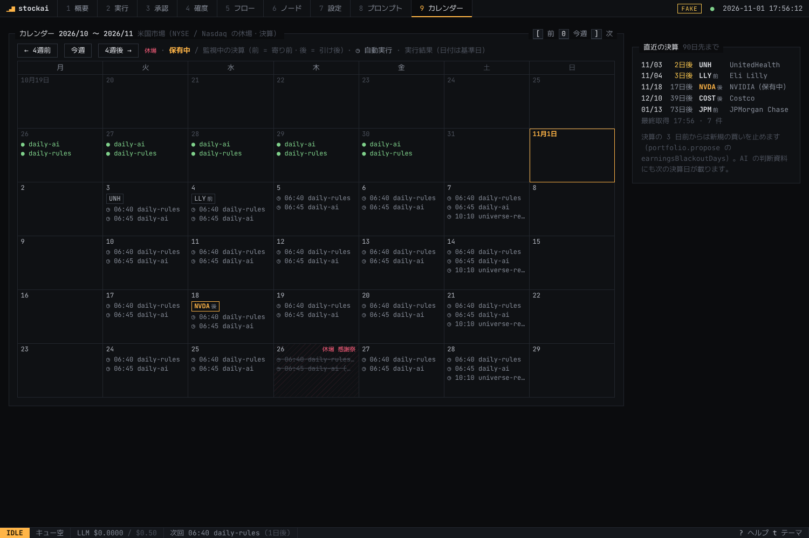

# 米国株で動かす

既定の設定（`config/config.example.yaml`）とワークフロー（`daily-ai` / `daily-rules` / `webull-us` / `ibkr-paper`）は米国株用。
日本株は `config/config.jp.example.yaml` と `daily-jp-ai` / `daily-jp-rules` / `webull-jp`（価格は J-Quants、記録は `data/jp` に分けて保存）。

## 使う情報源

| 種類 | ノード | 内容 | 必要なもの |
|---|---|---|---|
| 日足 | `data.pricesTwelveData` | [Twelve Data](https://twelvedata.com/) の日足（分割調整済み）。**ローカル（SQLite）に保存**し、2回目以降は直近の数本だけ取得。過去日付の再生はネット不要 | 無料の API キー（`TWELVEDATA_API_KEY`）。無料プラン: 800 回/日・8 回/分 |
| 開示 | `source.secFilings` | [SEC EDGAR](https://www.sec.gov/edgar) の 8-K（ウォッチリストの銘柄）。Item の説明と、本文・プレスリリース（EX-99.1）のテキスト | `SEC_USER_AGENT`（名前と連絡先メール。SEC の利用条件で必須）。キーは不要・無料 |
| ニュース | `source.rss` | 英語の RSS（`config.sources`。例は Yahoo Finance と Google News） | なし |

キーは Web UI の **⚙ 設定** で入れる（または `npm run stockai -- settings set TWELVEDATA_API_KEY`）。

### 回数の目安

- ウォッチリスト 11 銘柄 + ベンチマーク (SPY) = 1 日 12 回程度。無料枠（800 回/日）に十分収まる
- 8 回/分の制限に合わせて自動で間隔を空ける（12 銘柄で約 1.5 分）。同じ日の 2 本目のワークフロー（`daily-ai`）はノードのキャッシュを使うので取得しない
- 初回だけ約 1000 営業日分（4 年）を取得する。分割で過去の値が変わったときは自動で全期間を取り直す

### 時点管理（未来の情報を使わない）

- 価格: その日以前の足だけを渡す。米国の取引終了（UTC 20:00〜21:00）の後に取得した場合だけ、その日の足を確定とみなす
- SEC: EDGAR が **受理した時刻** から使う（`acceptanceDateTime` をニューヨーク時間として UTC に直す。誤っていても「遅く知った」側にずれるだけで、先読みにはならない）
- 実行日（`asOf`）は UTC の日付。日本時間の朝に動かすと、直前に閉じた米国の取引日になる

## 1日の流れ

```yaml
# config.example.yaml の schedule（サーバーの現地時間 = 日本時間を想定）
schedule:
  - { workflow: workflows/daily-rules.yaml, at: "06:40", days: [2, 3, 4, 5, 6] }   # 火〜土の朝
  - { workflow: workflows/daily-ai.yaml, at: "06:45", days: [2, 3, 4, 5, 6] }
```

1. 06:40 ルールのベースライン（価格・ニュース・開示・イベント抽出をここで済ませる）
2. 06:45 AI の判断（同じノードはキャッシュを使う）→ 承認待ち
3. 朝のうちに「2 承認」で確認。承認するとペーパー口座（$100,000）で約定
4. 米国の祝日は価格が増えないだけで、判断は前営業日のデータで行われる

## 設定の要点

| 項目 | 米国株 | 日本株 |
|---|---|---|
| `market.currency` / `benchmark` | `USD` / `SPY` | `JPY` / `1306` |
| `risk.lotSize` | 1 | 100 |
| `prompts.event` | `event-us-v1`（英語の 8-K・ニュース用） | `event-v1` / `event-v2` |
| 呼値 | $0.01 | 東証の呼値刻み |
| ブローカー | `webull.market: us` / `ibkr.market: us` | `jp` |

ウォッチリストの `name` と `aliases` はニュースの本文と単語単位で照合する（"Apple" は "Pineapple" には当たらない）。
SEC の銘柄は SEC のティッカー一覧から CIK を引く。見つからない銘柄は `source.secFilings` の `ciks: { TICKER: 1234567 }` で指定する。

## 銘柄を AI に探してもらう

「6 銘柄」の **AI に銘柄を探してもらう**。テーマ（「半導体・AI インフラ」「サイバーセキュリティ」「高配当・連続増配」などのボタン、または自由に書く）・数・規模を選んで「探す」。

1. 銘柄探しのモデル（プロンプト画面の「使うモデル」、既定は売買判断のエスカレーション）が候補とテーマとの関係（1文）を出す。今のウォッチリストの銘柄は除く
2. 各候補を **SEC の上場企業リスト**（ティッカー・社名・取引所、週1回取得）で確認する。リストに無い・NYSE / Nasdaq 以外・ティッカーと社名が合わない（AI の取り違え）ものは「✕ 除外」になり、選べない。`SEC_USER_AGENT` が未設定なら全件「? 未確認」（既定ではチェックが外れる）
3. チェックした銘柄を一覧に加え、内容を確認して「保存」。保存するまでは何も変わらない

注意:
- AI の知識は古いことがある（最近の上場・合併・社名変更）。確認済みでも、理由は参考程度に
- 流動性（売買代金）や時価総額は確かめていない。規模の希望は AI の知識に基づく
- 今日選んだ銘柄で**過去の日付を再生すると、後から見て伸びた銘柄を選んでいる偏り**（後知恵）が入る。確度の記録（今日以降の判断の採点）には影響しない
- LLM の呼び出しは1回（Gemini Flash で1円前後の見込み）で、日次予算に含まれる

## Claude と会話して銘柄を選ぶ（MCP）

Claude Desktop / Claude Code を stockai につなぐと（[mcp.md](mcp.md)）、プロンプト **「銘柄を探す」（`find_stocks`）** にテーマを入れるだけで、
今のウォッチリストの偏りを見ながら候補を説明つきで挙げ、SEC で確認し、選んだものを追加してくれる。
「この会社は何をしているの？」「黒字の会社だけにして」のように会話で絞り込める。追加は SEC の確認を通ったものだけ。

## ウォッチリストの定期見直し（ワークフロー）

`workflows/universe-review.yaml`。`config.example.yaml` では毎週土曜 10:10 に動くが、**提案は 28 日に1回**（それ以外の週はすぐ終わる。LLM も使わない）。

| | 基準 |
|---|---|
| 追加候補 | AI がテーマ（`themes`、空なら「今のセクターの偏りを補う」）から挙げ、SEC で確認、さらに Twelve Data で直近 20 日の売買代金が $20M 以上か確認（候補1件につき 1 回分のクレジット） |
| 削除候補 | 株価データが取れない・履歴が短い・売買代金が少ない（どれか1つ）、または「90 日間ニュース・開示が無い」と「40 日間 AI の判断がずっと中立」の両方。追加から 60 日以内の銘柄は後者で外さない。1回に最大 3 件 |
| 承認 | 承認待ちで止まり、Discord に通知。「2 承認」で追加・削除の一覧と理由を見て承認すると config.yaml に反映。7 日で期限切れ（何も変えない）。一部だけ採用したいときは却下して設定画面で編集 |
| 記録 | 承認した変更は「いつ・どこから（画面 / Claude / 見直し）・なぜ」を記録。次の見直しで、これまでに追加した銘柄の追加後の値動き（ベンチマーク比）をメモに出す |

- 保有中の銘柄を外しても、損切り・評価・売却の管理は続く（新しく買わなくなるだけ）
- 過去日付の再生では見直さない

## インサイダー売買（Form 4）と大量保有（13D）

| | 内容 |
|---|---|
| Form 4 | 役員・取締役・10%以上の大株主の自社株売買（取引から2営業日以内に開示）。`data.insider` ノードがウォッチリストと保有銘柄について EDGAR から新しい分だけ取得し、直近90日の**市場での買い（コード P）と売り（コード S）**をまとめる。報酬の株付与・オプション行使・贈与などは数えない |
| 使い方 | AI の判断資料に「## インサイダー売買」（誰が・いつ・いくら買ったか、売りのうち事前の売却計画 10b5-1 の件数）を載せる。合成スコアに `insider` 因子（買いだけ。金額・人数が多く、30日以内に3人以上が買った「クラスター」ほど高い。重み 0.15）を加える。ルールのベースラインにも同じスコアが入るので比較は公平 |
| 売りの扱い | スコアには入れない（報酬の現金化や事前の計画が多く、材料として弱い）。資料には件数と金額を出し、AI の判断に任せる |
| 13D | 5%超を取得し、経営に関与する意図がある（アクティビストなど）ときの開示。`source.secFilings` が 8-K と一緒に取得し、イベント抽出にかける（2024年12月以降の様式名 `SCHEDULE 13D` と旧様式 `SC 13D` の両方） |
| 時点管理 | EDGAR が受理した時刻から使う。過去日付の再生でも、その時点で公開済みだった取引だけを数える |
| 必要なもの | `SEC_USER_AGENT`（8-K と同じ）。無ければノードは何もせず、実行は失敗扱いにならない |

1回目は直近約100日分の Form 4 をまとめて取得する（大型株は1銘柄で数十件あるので数分かかることがある。上限 `maxFilings` 300 件）。2回目からは新しい分だけ。

## カレンダー（休場日と決算日）



| | 内容 |
|---|---|
| 休場日 | NYSE / Nasdaq の祝日（元日・キング牧師記念日・大統領の日・聖金曜日・戦没将兵追悼記念日・ジューンティーンス・独立記念日・労働者の日・感謝祭・クリスマス。土日に重なったときの振替も）を規則から計算。外部データは使わない。臨時休場と短縮取引は扱わない |
| 休場日の自動実行 | 基準日（UTC の日付 = 直前の米国の取引日）が休場日なら日次の実行をしない（新しいデータが無いため）。週末の見直しワークフローには影響しない。止めたくないエントリは `schedule` に `skipHolidays: false` |
| 過去日付の再生 | 米国株の設定では `--from/--to` を取引日だけで回す |
| 決算日 | `data.earnings` ノードが Alpha Vantage の決算予定（今後3か月・全米）を1日1回取得し、ウォッチリストと保有銘柄の次の決算日を出す。キー `ALPHAVANTAGE_API_KEY` は無料（「7 設定」で入力）。無ければノードは何もしない（実行は失敗扱いにならない） |
| 時点管理 | 決算日は「いつの取得で載っていたか」を記録し、過去日付の再生ではその日に分かっていた予定だけを使う（延期・前倒しが過去に漏れない） |
| AI の判断資料 | 「## 予定」に「次の決算発表: 2026-11-05（2日後・引け後） EPS 予想 1.85」の1行が加わる |
| リスクルール | 決算の **3日前から新規の買いを止める**（`portfolio.propose` の `earningsBlackoutDays`、0 で無効）。保有中の銘柄は売らない（決算前に売るかどうかは AI の判断に任せる） |
| カレンダー画面 | 「5 カレンダー」。`[` `]` で4週ずつ移動、`0` で今週 |

日本株（`config.jp.example.yaml`）は休場日・決算日とも未対応（カレンダーには自動実行と実行履歴だけが出る）。

## まだ確認できていないこと

まず ⚙ 設定の **接続チェック**（または `npm run stockai -- doctor`）で、下の項目のうち接続・キー・応答の形をまとめて確かめられる。

この開発環境からは Twelve Data・SEC・ニュースサイトに接続できなかったため、**応答の形式は公開ドキュメントとモックで確認しただけ**。最初の実行で次を確認する:

- [ ] `npm run stockai -- run workflows/daily-rules.yaml` で `prices` ノードが `full=12` になり、`show` で終値が妥当
- [ ] 2回目の実行で `update` になる（差分取得）
- [ ] `filings` ノードで直近の 8-K が取れる（決算期なら Item 2.02）。SEC が 403 を返す場合は `SEC_USER_AGENT` を見直す
- [ ] RSS の URL が生きているか（`news` ノードの `feedsFailed`）
- [ ] `npm run stockai -- eval events --models gemini-lite` で `event-us-v1` の正解率を見る
